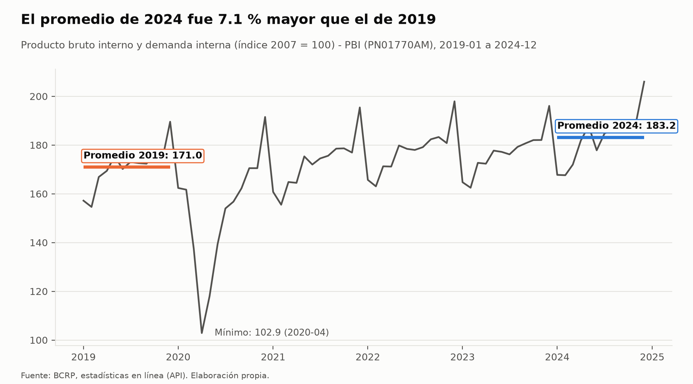
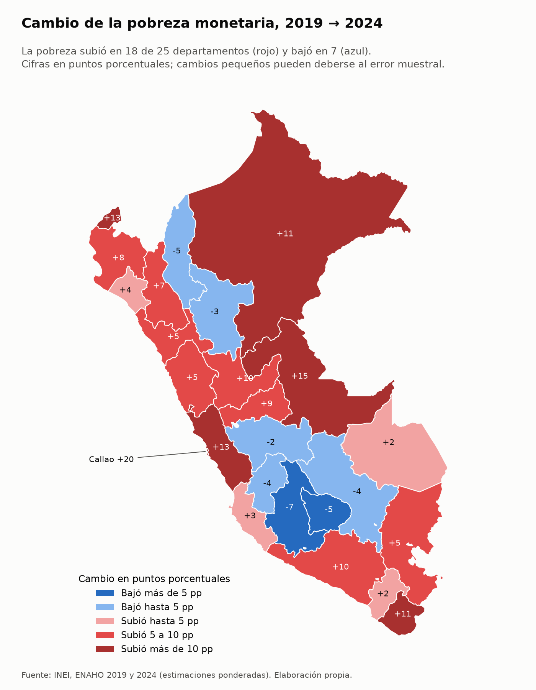

# Tarea 4 – Agente de investigación socioeconómica (MCP + Skills)

Agente construido sobre **Claude Code** que responde preguntas sobre la realidad socioeconómica del Perú con datos
oficiales:

- **BCRP**, a través de un servidor MCP propio.
- **INEI – ENAHO**, a través de tres Skills que limpian, grafican y mapean los microdatos.

Cada cifra sale de una herramienta que se puede volver a ejecutar, no de la memoria del modelo.

**Pregunta de investigación:** ¿La recuperación del PBI peruano entre 2019 y 2024 se reflejó en una menor pobreza
monetaria y desigualdad en los departamentos del país?

**Respuesta corta:** no.
- El PBI promedio de 2024 fue **7.14 %** mayor que el de 2019.
- La pobreza monetaria subió de **20.2 % a 27.6 %** y aumentó en **18 de 25 departamentos**. El aumento fue sobre
  todo urbano: Lima Metropolitana pasó de 14.2 % a 28.2 % y Callao subió 19.5 pp.
- La desigualdad del gasto sí bajó: el Gini pasó de 0.375 a 0.349.

Ver [`informes/informe_final.md`](informes/informe_final.md).

| Componente | Archivo | Estado |
|---|---|---|
| Servidor MCP del BCRP | [`mcp/server.py`](mcp/server.py) | 5 herramientas, 1 recurso, 1 prompt; `pytest` → **10 passed** |
| Skills de ENAHO | [`.claude/skills/`](.claude/skills/) | `limpiando-enaho` (15/15 validaciones), `graficando-enaho`, `mapeando-enaho` |
| Informe | [`informes/informe_final.md`](informes/informe_final.md) | 4 hallazgos, 6 gráficos y mapas, verificación manual de 4 cifras |
| Evaluación | [`evaluacion/`](evaluacion/) | Modo A **2/10** correctas vs. Modo B **10/10** |
| Evidencias de IA | [`evidencias_ia/`](evidencias_ia/) | Planificación, integración, evaluación, demos del MCP y de las Skills |

---

## 1. Objetivo

Construir un agente que:

1. Interprete una pregunta en lenguaje natural.
2. Consulte las series del BCRP mediante herramientas MCP.
3. Procese los microdatos de la ENAHO mediante Skills que validan sus resultados contra las cifras oficiales.
4. Produzca gráficos, mapas y un informe en el que cada número se pueda rastrear hasta su fuente.

Se usa para contrastar la recuperación económica agregada (PBI, BCRP) con la pobreza monetaria y la desigualdad de
los hogares (ENAHO 2019 y 2024), a nivel nacional, urbano/rural y departamental. Además, se mide con un experimento
si el MCP y las Skills mejoran las respuestas de Claude Code frente al modelo sin herramientas.

## 2. Arquitectura del agente

```text
                    Pregunta en lenguaje natural
                                │
                                ▼
                    ┌────────────────────────┐
                    │      Claude Code       │  planifica y coordina
                    └────────────────────────┘
                 ┌──────────────┴───────────────┐
                 ▼                              ▼
      Servidor MCP `bcrp`                Skills (.claude/skills/)
      (mcp/server.py, stdio)             ┌─────────────────────────┐
      buscar_series                      │ limpiando-enaho         │─► salidas/indicadores.csv
      serie · resumen                    │   valida → validacion.txt│   salidas/*.parquet
      comparar_periodos                  ├─────────────────────────┤
      graficar_serie ─► figuras/bcrp_*   │ graficando-enaho        │─► figuras/*.png + *.csv
      recurso bcrp://serie/{codigo}      ├─────────────────────────┤
      prompt informe                     │ mapeando-enaho          │─► mapas/*.png
                 │                       └─────────────────────────┘
                 ▼                              ▼
       API del BCRP (JSON)              datos/ (ENAHO .dta, GeoJSON)
                 └──────────────┬───────────────┘
                                ▼
                    informes/informe_final.md
```

**Principios de diseño:**
- **Las cuentas las hace Python, no el modelo.** `resumen` y `comparar_periodos` calculan promedios y variaciones,
  y las Skills calculan tasas ponderadas y el Gini.
- **Cada resultado trae su fuente.** Las respuestas del MCP incluyen la URL de la API del BCRP, y cada gráfico
  tiene un CSV gemelo con los valores graficados.
- **Validar antes de usar.** `limpiando-enaho` se detiene si falla una validación esencial y no guarda la base
  limpia. Las otras dos Skills exigen que exista la base limpia y, si falta, piden ejecutar primero la limpieza.
- **La planificación** de la ejecución integrada está en
  [`evidencias_ia/integracion/prompt.md`](evidencias_ia/integracion/prompt.md). Allí se indica qué serie buscar, qué
  herramienta usar en cada paso, qué Skills encadenar y qué secciones debe tener el informe.

## 3. Herramientas MCP (`mcp/server.py`)

El servidor se construyó con **FastMCP** a partir de la plantilla de la Sesión 04.

| Tipo | Nombre | Qué hace |
|---|---|---|
| Herramienta | `buscar_series(texto, frecuencia, limite)` | Busca códigos en el catálogo del BCRP, que se descarga y guarda en `mcp/datos/` la primera vez |
| Herramienta | `serie(codigo, desde, hasta)` | Descarga los datos oficiales. Acepta fechas mensuales `2025-01`, trimestrales `2025-T1`, anuales `2025` y diarias `2026-10-01`. Omite los «n.d.» y reintenta si la API limita los pedidos |
| Herramienta | `resumen(codigo, desde, hasta)` | Primer y último dato, cambio, variación %, promedio, máximo, mínimo y número de observaciones |
| Herramienta **propia** | `comparar_periodos(codigo, desde_a, hasta_a, desde_b, hasta_b)` | Compara una serie en dos intervalos: promedio, mínimo y máximo de cada uno, diferencia de promedios y variación %. Advierte si los intervalos tienen distinto número de datos. Responde preguntas como «¿el PBI de 2024 superó al de 2019?» |
| Herramienta **propia** | `graficar_serie(codigo, desde, hasta, promedios_de, archivo)` | Grafica la serie y marca los promedios anuales pedidos. Guarda `figuras/<archivo>.png` y `.csv`; el título se arma con los datos |
| Recurso | `bcrp://serie/{codigo}` | Ficha de la serie: nombre, frecuencia, unidad, origen, descripción y enlace web |
| Prompt | `informe(tema, desde, hasta)` | Plantilla para un informe breve y verificable sobre un indicador |

**Pruebas** ([`mcp/test_server.py`](mcp/test_server.py)): las 8 originales de la Sesión 04, sin modificar, más 2
propias para `comparar_periodos`:
- una verifica el PBI 2019 vs. 2024 (promedios 170.98 y 183.18, variación 7.14 %);
- la otra verifica que se rechacen los códigos y las fechas inválidos.

Series usadas:

| Código | Serie |
|---|---|
| `PN01770AM` | PBI, índice 2007 = 100, mensual |
| `PN01728AM` | PBI, var. % interanual, mensual |
| `PM04923AA` | PBI, var. % real anual |
| `PN01273PM` | IPC Lima, var. % 12 meses |

## 4. Skills (`.claude/skills/`)

Cada Skill tiene un `SKILL.md`, con la descripción que activa la Skill y los pasos, y un script en `scripts/` que
hace el trabajo.

### `limpiando-enaho`

Instrucciones en [`SKILL.md`](.claude/skills/limpiando-enaho/SKILL.md) y reglas en
[`reference.md`](.claude/skills/limpiando-enaho/reference.md). Se ejecuta con
`uv run .claude/skills/limpiando-enaho/scripts/limpiar.py --anio 2024` (o `--anio 2019`).

**Qué hace:**
- Lee la sumaria (módulo 34) y los miembros del hogar (módulo 02) **desde los zip**, con las llaves como texto.
- Filtra a los residentes habituales.
- Une personas con hogares con `validate="m:1"` y comprueba que la unión no duplique filas.
- Construye `departamento = ubigeo[:2]`, `urbano = estrato ≤ 5`, `pobre = pobreza ≤ 2` y el gasto real per cápita.
- Calcula la pobreza y el **Gini del gasto**, ponderados con `factor07 × mieperho` (o `facpob07` para personas).

**Validaciones** (en `salidas/validacion.txt`):
- Llaves únicas, factores válidos y 25 departamentos, con Lima y Callao separados.
- Pobreza nacional de 27.6 % (±0.1 pp) y 108,664 residentes.
- La unión no duplica filas.
- Pobreza urbana 24.8 %, rural 39.3 % y de Lima Metropolitana 28.2 %.

Resultado: **15/15 en 2024 y 6/6 en 2019**. Si falla una validación esencial, se detiene sin guardar la base.

**Salidas:** `salidas/indicadores.csv`, por año (nacional, área, Lima Metropolitana y departamento), y
`hogares_*.parquet` y `personas_2024.parquet`, que no se suben al repositorio.

**¿Por qué el Gini del gasto y no del ingreso?** Por cuatro razones:
1. El INEI mide la pobreza monetaria con el gasto per cápita, así que pobreza y desigualdad usan la misma variable.
2. El gasto es más estable que el ingreso de los hogares informales.
3. El gasto se declara con menos error; el ingreso suele subdeclararse.
4. Es la medida habitual del INEI y del Banco Mundial para el Perú.

Por eso **no es comparable** con un Gini del ingreso, que suele ser más alto.

### `graficando-enaho`

Instrucciones en [`SKILL.md`](.claude/skills/graficando-enaho/SKILL.md). Se ejecuta con
`uv run .claude/skills/graficando-enaho/scripts/graficar.py <grafico>`. Gráficos disponibles:

| Opción | Muestra |
|---|---|
| `area` | Pobreza urbana y rural |
| `sexo` | Pobreza por sexo |
| `edad` | Pobreza por edad |
| `departamento` | Pobreza en los 25 departamentos (2024) |
| `comparacion` | Pobreza 2019 vs. 2024 |
| `gini` | Gini 2019 vs. 2024 |
| `cambio` | Cambio de la pobreza por departamento |
| `todos` | Todos los anteriores |

- Siempre usa estimaciones ponderadas.
- El título se calcula con los datos y el pie cita la fuente.
- Cada `figuras/<nombre>.png` va con su `figuras/<nombre>.csv`.

### `mapeando-enaho`

Instrucciones en [`SKILL.md`](.claude/skills/mapeando-enaho/SKILL.md). Se ejecuta con
`uv run .claude/skills/mapeando-enaho/scripts/mapear.py pobreza|cambio|todos`.

- Hace un mapa coroplético de la pobreza departamental 2024 (escala secuencial) y otro del cambio 2019→2024 (escala
  divergente).
- Une los datos con el mapa **por código** (`ubigeo[:2]` = `FIRST_IDDP`), nunca por nombre, y exige las 25
  unidades con dato.
- Compara la pobreza 2024 con la tabla de referencia de la Sesión 16 (diferencia máxima 0.1 pp).
- Escribe los resultados en `salidas/validacion_mapa.txt`.

**Coordinación:** si falta `salidas/indicadores.csv`, las Skills de gráficos y de mapas piden ejecutar primero
`limpiando-enaho`. Por ejemplo, «Haz un mapa de la pobreza por departamento» encadena limpieza → mapa.

## 5. Fuentes y descarga de datos

| Fuente | Datos | Enlace |
|---|---|---|
| INEI | ENAHO 2024, módulo 34 (sumaria) | https://proyectos.inei.gob.pe/iinei/srienaho/descarga/STATA/966-Modulo34.zip |
| INEI | ENAHO 2024, módulo 02 (miembros) | https://proyectos.inei.gob.pe/iinei/srienaho/descarga/STATA/966-Modulo02.zip |
| INEI | ENAHO 2019, módulo 34 (sumaria) | https://proyectos.inei.gob.pe/iinei/srienaho/descarga/STATA/687-Modulo34.zip |
| Curso | Límites departamentales (GeoJSON) | https://raw.githubusercontent.com/d2cml-ai/Data-Science-Python/main/sessions/06-geoespacial/lab/Data/peru_departamental_simple.geojson |
| BCRP | Series estadísticas (API) | https://estadisticas.bcrp.gob.pe/estadisticas/series/ |
| Curso | Pobreza departamental 2024 de referencia | [`referencias/pobreza_departamento_2024.csv`](referencias/pobreza_departamento_2024.csv) (Sesión 16) |

Para descargar los datos, desde la raíz del repositorio:

```bash
mkdir -p datos && cd datos
curl -LO https://proyectos.inei.gob.pe/iinei/srienaho/descarga/STATA/966-Modulo34.zip
curl -LO https://proyectos.inei.gob.pe/iinei/srienaho/descarga/STATA/966-Modulo02.zip
curl -LO https://proyectos.inei.gob.pe/iinei/srienaho/descarga/STATA/687-Modulo34.zip
curl -LO https://raw.githubusercontent.com/d2cml-ai/Data-Science-Python/main/sessions/06-geoespacial/lab/Data/peru_departamental_simple.geojson
cd ..
```

Los zip no se descomprimen: los scripts los leen directamente. La carpeta `datos/` está en `.gitignore`.

## 6. Instalación con `uv`

Requiere Python 3.12 o superior y [uv](https://docs.astral.sh/uv/).

```bash
git clone https://github.com/grey-d18/Tarea-4.git
cd Tarea-4
uv sync          # instala fastmcp, httpx, pandas, pyarrow, geopandas, matplotlib y pytest
```

## 7. Conectar el MCP a Claude Code

El servidor ya está declarado en [`.mcp.json`](.mcp.json):

```json
{ "mcpServers": { "bcrp": { "command": "uv", "args": ["run", "mcp/server.py"] } } }
```

1. Abre `claude` en la raíz del repositorio y aprueba el servidor `bcrp` del proyecto.
2. Con `/mcp`, comprueba que aparezca `bcrp · connected` con 5 herramientas.
3. Para probarlo:
   - Herramienta: «¿Cuánto creció el PBI del Perú en 2024 según el BCRP?»
   - Recurso: `@bcrp:bcrp://serie/PN01770AM`
   - Prompt: `/mcp__bcrp__informe PBI`

Si prefieres registrarlo a mano: `claude mcp add --scope project bcrp -- uv run mcp/server.py`.

Las Skills se cargan solas desde `.claude/skills/`. Se pueden invocar con `/limpiando-enaho 2024` o activar con
lenguaje natural, por ejemplo «Grafica la pobreza urbana y rural con la ENAHO 2024».

## 8. Reproducir el procesamiento y las pruebas

```bash
uv run pytest -q                                                    # 10 passed

# ENAHO (requiere los datos de la sección 5)
uv run .claude/skills/limpiando-enaho/scripts/limpiar.py --anio 2024   # → salidas/validacion.txt (15/15)
uv run .claude/skills/limpiando-enaho/scripts/limpiar.py --anio 2019   # → salidas/validacion_2019.txt (6/6)
uv run .claude/skills/graficando-enaho/scripts/graficar.py todos       # → figuras/
uv run .claude/skills/mapeando-enaho/scripts/mapear.py todos           # → mapas/ y salidas/validacion_mapa.txt

# Respuestas esperadas de la evaluación (verificación independiente: API del BCRP directa + recálculo propio)
uv run evaluacion/verificar_respuestas.py

# Evaluación Modo A vs. Modo B (llama a Claude Code; tarda ~10 min y tiene costo)
uv run evaluacion/evaluar.py --modelo sonnet
```

El gráfico del BCRP se genera con la herramienta MCP
`graficar_serie("PN01770AM", "2019-01", "2024-12", ["2019", "2024"], "bcrp_pbi_2019_2024")`. El BCRP puede revisar
cifras recientes, así que una descarga posterior podría diferir levemente.

## 9. Resultados de la evaluación

La evaluación usó 10 preguntas: 4 del BCRP, 4 de la ENAHO y 2 que combinan ambas fuentes.
- Las respuestas esperadas se verificaron de forma independiente, sin usar el MCP ni las Skills.
- Las tolerancias se fijaron **antes** de ejecutar. Ver [`evaluacion/protocolo.md`](evaluacion/protocolo.md).
- Cada pregunta se corrió en una sesión nueva de `claude -p`, con Sonnet en ambos modos.

| | Modo A (sin MCP ni Skills, sin herramientas) | Modo B (MCP + Skills) |
|---|---|---|
| Correctas | **2 / 10** | **10 / 10** |
| Incorrectas | 2 (PBI 2024: 3.30 vs. 3.52; abril 2020: −40.5 vs. −39.28) | 0 |
| No responde | 6 | 0 |
| Tiempo promedio | 7.1 s | 11.4 s |
| Costo total | 0.16 USD | 0.57 USD |

- **Mejoraron 8 preguntas** y ninguna empeoró.
- Sin herramientas, el modelo **se abstiene** con los datos que no conoce (pobreza por departamento, promedios del
  índice) y **se equivoca sin advertirlo** con los que cree conocer.

Detalle en [`evaluacion/comparacion.md`](evaluacion/comparacion.md), [`evaluacion/resultados.csv`](evaluacion/resultados.csv)
y las 20 sesiones en [`evaluacion/registros/`](evaluacion/registros/).

## 10. Limitaciones y problemas encontrados

**Del análisis:**
- **PBI y ENAHO miden cosas distintas.** El PBI es producción nacional agregada y no hay PBI departamental en el
  análisis; la ENAHO mide el gasto de los hogares. Solo se comparan dos años, 2019 y 2024, y las conclusiones son
  descriptivas, no causales.
- **Error muestral.** Los cambios departamentales pequeños (por ejemplo Junín o Moquegua) pueden no ser
  significativos, y no se calcularon intervalos de confianza.
- **Pobreza monetaria ≠ bienestar.** El análisis no incluye pobreza multidimensional. El Gini es del gasto y no es
  comparable con un Gini de ingresos.
- **Sexo y edad solo en 2024.** Para 2019 se usó solo la sumaria, así que las comparaciones son nacionales, por
  área, de Lima Metropolitana y por departamento.

**Del sistema:**
- **La API del BCRP limita los pedidos** y en ese caso responde HTML en lugar de JSON. El servidor reintenta con
  espera creciente y guarda en caché lo descargado.
- **Error encontrado en la ejecución integrada.** Al correr `mapear.py pobreza` y luego `mapear.py cambio`, el
  segundo borraba la validación del primero en `validacion_mapa.txt`, y se ve en la sesión exportada. Se corrigió
  para que cada mapa tenga su propia sección.
- **El modo B de la evaluación no ejecutó las Skills.** Leyó los resultados que ya estaban en `salidas/`, y respondió
  la pobreza nacional de memoria, aunque acertó. Una evaluación más exigente borraría `salidas/` antes del modo B y
  repetiría cada pregunta varias veces.
- **`/export` de Claude Code colapsa las llamadas al MCP.** Por eso se agregó un anexo con cada llamada, sus
  parámetros y sus respuestas: [`anexo_llamadas_herramientas.md`](evidencias_ia/integracion/anexo_llamadas_herramientas.md).
- **El informe tiene partes agregadas a mano.** La sección 1 (tema, objetivo y delimitación) se completó después
  de la ejecución del agente, y así se indica en el propio informe. La sección 8 es la verificación manual.
- **Carpeta del proyecto.** El proyecto está en un repositorio independiente, con la estructura en la raíz, en lugar
  de una carpeta `tarea_4/`; la consigna permite ambas opciones.

## 11. Ejemplo de ejecución completa

Se hizo en una sola sesión de Claude Code, el 7 de noviembre de 2026, con Opus. Partió sin salidas previas
(`rm salidas/indicadores.csv salidas/*.parquet figuras/* mapas/*`) y se le dio el prompt de
[`evidencias_ia/integracion/prompt.md`](evidencias_ia/integracion/prompt.md).

| # | Paso | Herramienta | Resultado |
|---|---|---|---|
| 1 | Elegir la serie | `buscar_series("pbi índice 2007", "Mensual")` | PN01770AM; los otros índices eran sectoriales |
| 2 | Comparar 2019 con 2024 | `comparar_periodos("PN01770AM", "2019-01", "2019-12", "2024-01", "2024-12")` | 170.98 → 183.18 (+7.14 %) |
| 3 | Resumen del periodo | `resumen("PN01770AM", "2019-01", "2024-12")` | Mínimo 102.88 (abril 2020) |
| 4 | Gráfico del BCRP | `graficar_serie(...)` | `figuras/bcrp_pbi_2019_2024.png` |
| 5 | Ficha de la serie | Recurso `bcrp://serie/PN01770AM` | Origen: INEI, MIDAGRI, MINEM, PRODUCE |
| 6 | Limpieza y validación | Skill `limpiando-enaho`, 2024 y 2019 | 15/15 y 6/6 validaciones |
| 7 | Gráficos de la ENAHO | Skill `graficando-enaho`: `comparacion`, `gini`, `cambio` | 3 gráficos con su CSV |
| 8 | Mapas | Skill `mapeando-enaho`: `pobreza`, `cambio` | 25/25 departamentos; máx. 0.1 pp frente a la referencia |
| 9 | Informe | Write | [`informes/informe_final.md`](informes/informe_final.md) |

Después se verificaron a mano 4 cifras: pobreza nacional, urbana y rural frente a la consigna, y el PBI promedio con
una hoja de cálculo. Todas coinciden; ver la sección 8 del informe.

Resultado:




## 12. Evidencias del uso de IA

Todo el proyecto se desarrolló con Claude Code (Opus) como asistente. Las conversaciones están en
[`evidencias_ia/`](evidencias_ia/), exportadas en Markdown. Se reemplazaron las rutas y los datos personales; no hay
claves ni tokens.

| Carpeta | Contenido |
|---|---|
| [`planificacion/`](evidencias_ia/planificacion/) | Conversación principal de desarrollo: elección de la pregunta, servidor MCP, pruebas, Skills, correcciones, preguntas de evaluación, revisión del informe y README |
| [`mcp/`](evidencias_ia/mcp/) | Demostración del servidor en Claude Code: `/mcp`, una herramienta, el recurso y el prompt |
| [`skills/`](evidencias_ia/skills/) | Demostración de las Skills: invocación directa, activación por lenguaje natural y encadenamiento limpieza → mapa |
| [`integracion/`](evidencias_ia/integracion/) | Prompt, sesión exportada, anexo de llamadas a herramientas y captura de la verificación manual del PBI |
| [`evaluacion/`](evidencias_ia/evaluacion/) | Remite a [`evaluacion/registros/`](evaluacion/registros/), con las 20 sesiones de los modos A y B en JSON |

El avance paso a paso está en [`PLAN.md`](PLAN.md) y en el historial de commits.
