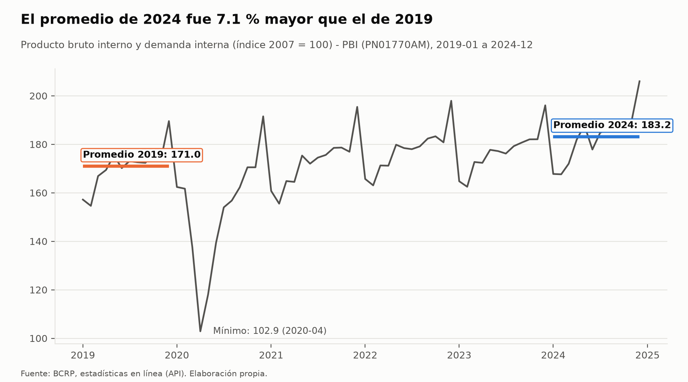
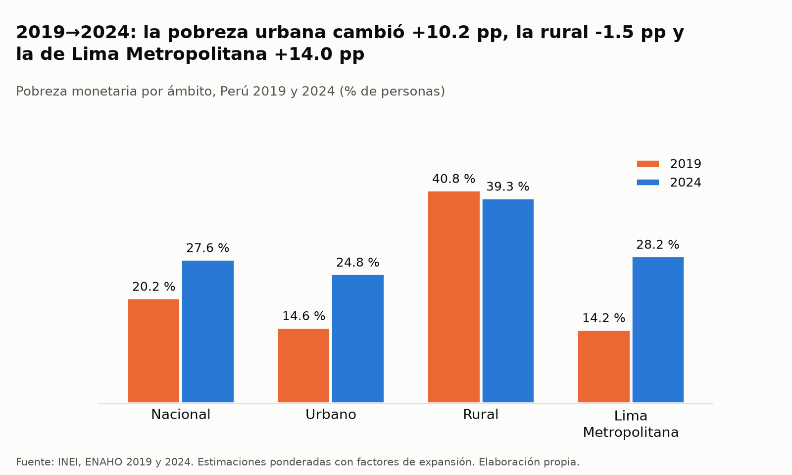
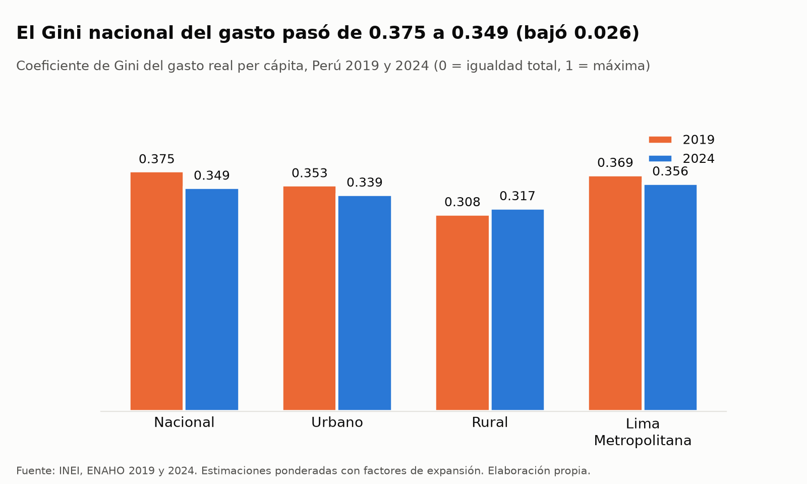
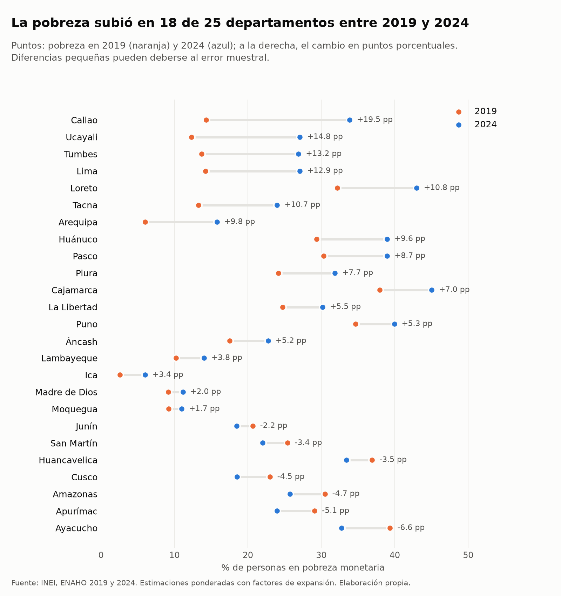
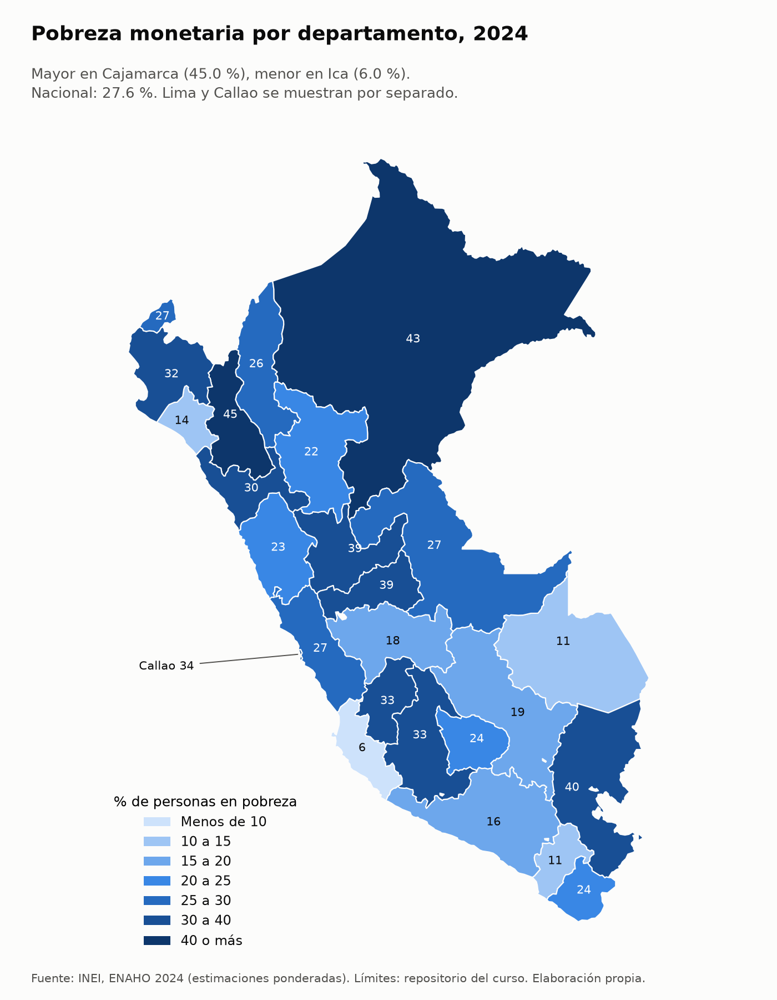
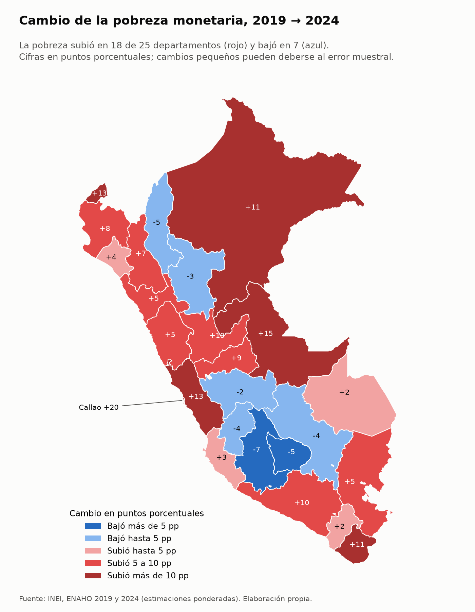

# Crecimiento del PBI, pobreza y desigualdad en el Perú, 2019–2024

## 1. Pregunta de investigación

¿La recuperación del PBI peruano entre 2019 y 2024 se reflejó en una menor pobreza monetaria y desigualdad en los
departamentos del país?

## 2. Metodología

**Fuentes**

| Fuente | Qué se usó | Detalle |
|---|---|---|
| BCRP, API de series estadísticas | PBI mensual, índice 2007 = 100, serie **PN01770AM** («Producto bruto interno y demanda interna (índice 2007 = 100) - PBI»), enero 2019–diciembre 2024 | Origen declarado en la ficha (`bcrp://serie/PN01770AM`): INEI, MIDAGRI, MINEM y PRODUCE. Consulta web: https://estadisticas.bcrp.gob.pe/estadisticas/series/mensuales/resultados/PN01770AM/html |
| INEI, ENAHO 2024 (código 966) | Módulo 34 (sumaria) y módulo 02 (miembros del hogar) | `datos/966-Modulo34.zip`, `datos/966-Modulo02.zip` |
| INEI, ENAHO 2019 (código 687) | Módulo 34 (sumaria) | `datos/687-Modulo34.zip` |
| Límites departamentales | GeoJSON de los 25 departamentos | `datos/peru_departamental_simple.geojson` |

**Elección de la serie del BCRP.** `buscar_series("pbi índice 2007", frecuencia="Mensual")` devolvió el PBI total
(PN01770AM) junto con índices sectoriales (manufactura, pesca, comercio, construcción, etc.). Elegí PN01770AM porque
es el único que mide la producción de **toda** la economía; es mensual, real (índice de volumen con base 2007, sin
efecto de precios) y empieza en 1994, así que cubre todo 2019–2024.

**Ponderación.** Todas las cifras de la ENAHO son estimaciones expandidas a la población:
- Indicadores de hogares (sumaria 2019 y 2024): peso por personas = `factor07 × mieperho`. Se usa el mismo método en
  ambos años para que la comparación sea consistente.
- Indicadores de personas (2024): `facpob07`, solo sobre residentes habituales.

**Definiciones.**
- *Pobreza monetaria*: porcentaje de personas en hogares cuyo gasto per cápita está por debajo de la línea de pobreza
  del INEI (variable `pobreza` ≤ 2 en la sumaria; pobreza extrema = 1).
- *Gini*: coeficiente de Gini del **gasto real per cápita** (`gashog2d / (12 × mieperho × ld)`, precios de Lima
  Metropolitana con el deflactor espacial `ld`), ponderado por personas. Va de 0 (igualdad total) a 1.
  Se usa el **gasto** y no el ingreso (`inghog2d`) por cuatro razones:
  1. Es la misma variable con la que el INEI define la pobreza monetaria, así que pobreza y desigualdad se miden
     igual.
  2. Es más estable que el ingreso, que en los hogares informales varía mucho de un mes a otro.
  3. En las encuestas se declara con menos error que el ingreso, que suele subdeclararse.
  4. Es la medida habitual del INEI y del Banco Mundial para el Perú.

  Por eso este Gini **no es comparable** con cifras de Gini del ingreso, que suelen ser más altas porque los
  hogares de mayores ingresos ahorran parte de lo que ganan.
- *Departamento*: `ubigeo[:2]`, 25 unidades con Lima (15) y Callao (07) separados.

**Herramientas MCP (servidor `bcrp`, `mcp/server.py`)**: `buscar_series`, `comparar_periodos`, `resumen`,
`graficar_serie` y el recurso `bcrp://serie/{codigo}`.

**Skills del proyecto (`.claude/skills/`)**: `limpiando-enaho` (limpieza, unión y validación; 15/15 verificaciones
aprobadas en 2024 y 6/6 en 2019, ver `salidas/validacion.txt` y `salidas/validacion_2019.txt`), `graficando-enaho`
(gráficos `comparacion`, `gini` y `cambio`) y `mapeando-enaho` (mapas `pobreza` y `cambio`; unión por código con
25/25 departamentos y diferencia máxima de 0.1 pp frente a `referencias/pobreza_departamento_2024.csv`).

## 3. Hallazgos

1. **El PBI de 2024 superó al de 2019.** El promedio del índice fue 170.98 en 2019 y 183.18 en 2024: un nivel
   **7.14 % mayor** (diferencia de 12.20 puntos del índice). Entre enero de 2019 y diciembre de 2024 el mínimo fue
   **102.88 en abril de 2020** (confinamiento) y el último dato, **205.997 en diciembre de 2024**, fue el máximo del
   periodo.
   *Fuente:* BCRP, serie PN01770AM, `comparar_periodos` y `resumen`;
   https://estadisticas.bcrp.gob.pe/estadisticas/series/api/PN01770AM/json/2019-1/2024-12

2. **La pobreza monetaria nacional fue mayor en 2024 que en 2019.** Pasó de **20.19 %** a **27.58 %** de la
   población (**+7.39 pp**). El aumento se concentró en las zonas urbanas (14.58 % → 24.81 %, +10.23 pp) y sobre
   todo en Lima Metropolitana (14.20 % → 28.21 %, +14.01 pp); en el área rural la cifra bajó ligeramente
   (40.78 % → 39.30 %, −1.48 pp), una diferencia pequeña que puede estar dentro del error muestral.
   *Fuente:* `salidas/indicadores.csv` y `figuras/pobreza_2019_vs_2024.csv`.

3. **En 18 de los 25 departamentos la pobreza estimada de 2024 fue mayor que la de 2019.** Los mayores aumentos se
   registraron en Callao (14.34 % → 33.86 %, +19.52 pp), Ucayali (+14.75 pp), Tumbes (+13.21 pp) y Lima
   (+12.86 pp). Bajó en 7 departamentos, todos de la sierra o la selva: Ayacucho (−6.60 pp), Apurímac (−5.13 pp),
   Amazonas (−4.74 pp), Cusco (−4.46 pp), Huancavelica (−3.51 pp), San Martín (−3.36 pp) y Junín (−2.16 pp).
   En 2024 las tasas más altas fueron las de Cajamarca (45.01 %) y Loreto (42.97 %).
   *Fuente:* `figuras/pobreza_cambio_departamento.csv` (a partir de `salidas/indicadores.csv`).

4. **La desigualdad del gasto bajó a nivel nacional, pero no en el área rural.** El Gini del gasto real per cápita
   pasó de **0.3751** (2019) a **0.3494** (2024), −0.0257. También bajó en el área urbana (−0.0146) y en Lima
   Metropolitana (−0.0134), mientras que en el área rural subió levemente (0.3080 → 0.3174, +0.0094).
   *Fuente:* `figuras/gini_2019_vs_2024.csv` y `salidas/indicadores.csv`.

## 4. Gráficos



El índice mensual del PBI (PN01770AM) cae con fuerza en abril de 2020 y luego se recupera; los tramos horizontales
marcan que el promedio de 2024 quedó 7.1 % por encima del de 2019.



La pobreza monetaria de 2024 (azul) supera a la de 2019 (naranja) a nivel nacional, urbano y en Lima Metropolitana,
y queda casi igual en el área rural.



El Gini del gasto real per cápita es menor en 2024 que en 2019 a nivel nacional y urbano, y algo mayor en el área
rural.



Cambio en puntos porcentuales de la pobreza entre 2019 y 2024 en cada departamento, ordenado de la mayor caída
(Ayacucho) al mayor aumento (Callao).



Porcentaje de personas en pobreza monetaria en 2024 por departamento: solo Cajamarca (45 %) y Loreto (43 %) están en
el tramo de 40 % o más, mientras que Ica (6 %) es el único por debajo de 10 %.



Cambio de la pobreza 2019→2024 en escala divergente: en rojo los 18 departamentos donde subió (los tonos más
intensos, más de 10 pp, en Callao, Lima, Tumbes, Loreto, Ucayali y Tacna) y en azul los 7 donde bajó (el centro-sur
andino, Amazonas y San Martín).

## 5. Interpretación

Los datos no muestran que la recuperación del PBI se haya acompañado de menos pobreza: aunque la producción promedio
de 2024 fue 7.14 % mayor que la de 2019, la pobreza monetaria nacional estimada por la ENAHO fue 7.39 pp más alta
(27.58 % frente a 20.19 %) y aumentó en 18 de los 25 departamentos, con los incrementos más grandes en zonas urbanas
y costeras como Lima Metropolitana y Callao; solo un grupo de departamentos andinos y amazónicos muestra descensos,
varios de ellos de magnitud cercana al error muestral. La desigualdad del gasto, en cambio, sí fue menor en 2024
(Gini de 0.3751 a 0.3494), aunque esto ocurre junto con más pobreza y no necesariamente refleja una mejora de los
hogares de menores ingresos. En conjunto, el mayor nivel de actividad agregada coexistió con más pobreza y algo menos
de desigualdad medida; estos datos describen asociaciones en dos momentos del tiempo y no permiten afirmar qué causó
cada cambio (inflación de alimentos de 2022–2023, mercado laboral, transferencias u otros factores no se analizaron
aquí).

## 6. Limitaciones

- **Nivel macro vs. hogares.** El PBI mide la producción agregada del país (y una sola serie nacional); la ENAHO
  mide el gasto de los hogares. El PBI puede crecer sin que el gasto de los hogares pobres lo haga, y no hay aquí un
  PBI departamental para comparar territorio por territorio.
- **Error muestral.** Las cifras de la ENAHO son estimaciones de una muestra: por departamento hay entre 603 y 4,544
  hogares en 2024 y entre 642 y 4,514 en 2019. Cambios de pocos puntos (por ejemplo Junín, Moquegua, Madre de Dios o
  el área rural) pueden no ser estadísticamente distintos de cero; no se calcularon intervalos de confianza.
- **Pobreza monetaria vs. bienestar.** La pobreza monetaria solo compara el gasto con una línea; no recoge acceso a
  servicios, salud, educación o vivienda (pobreza multidimensional). El Gini es del gasto, no del ingreso ni de la
  riqueza, y suele ser menor que un Gini de ingresos.
- **Comparabilidad 2019–2024.** Se usó el mismo método (sumaria, `factor07 × mieperho`) en ambos años y las cifras
  nacionales coinciden con las oficiales del INEI (20.2 % y 27.6 %), pero la pandemia afectó el trabajo de campo de
  la ENAHO en 2020–2021 y las líneas de pobreza se actualizan cada año por inflación. El gasto real per cápita de
  `salidas/indicadores.csv` solo está deflactado espacialmente (precios de Lima de cada año), por eso no se compara
  en el tiempo.
- **Cobertura departamental de la ENAHO.** La ENAHO es representativa a nivel de departamento, pero no de provincias
  o distritos; además la heterogeneidad interna (por ejemplo costa y sierra de un mismo departamento) queda oculta en
  el promedio departamental. El departamento «Lima» (15) excluye a Callao pero mezcla Lima Metropolitana y Lima
  Provincias.

## 7. Reproducibilidad

Desde la raíz del repositorio:

```bash
uv sync                                   # dependencias
uv run pytest -q                          # pruebas del servidor MCP

# ENAHO: limpieza y validación (requiere los zip en datos/)
uv run .claude/skills/limpiando-enaho/scripts/limpiar.py --anio 2024
uv run .claude/skills/limpiando-enaho/scripts/limpiar.py --anio 2019

# ENAHO: gráficos
uv run .claude/skills/graficando-enaho/scripts/graficar.py comparacion
uv run .claude/skills/graficando-enaho/scripts/graficar.py gini
uv run .claude/skills/graficando-enaho/scripts/graficar.py cambio

# ENAHO: mapas
uv run .claude/skills/mapeando-enaho/scripts/mapear.py pobreza
uv run .claude/skills/mapeando-enaho/scripts/mapear.py cambio
```

BCRP (servidor `bcrp` declarado en `.mcp.json`, se inicia con `uv run mcp/server.py`), llamadas desde Claude Code:

```text
buscar_series("pbi índice 2007", frecuencia="Mensual")
comparar_periodos("PN01770AM", "2019-01", "2019-12", "2024-01", "2024-12")
resumen("PN01770AM", "2019-01", "2024-12")
graficar_serie("PN01770AM", "2019-01", "2024-12", promedios_de=["2019", "2024"], archivo="bcrp_pbi_2019_2024")
recurso bcrp://serie/PN01770AM
```

Los datos del gráfico del BCRP quedan en `figuras/bcrp_pbi_2019_2024.csv`; la API puede revisar cifras recientes, así
que una descarga posterior podría diferir levemente.

## 8. Verificación manual

| cifra | valor del informe | cómo la verifiqué | ¿coincide? |
|---|---|---|---|
|  |  |  |  |
|  |  |  |  |
|  |  |  |  |
